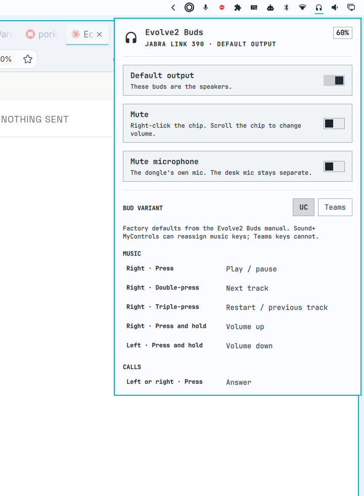

# Jabra Buds



A bar chip for [Jabra Evolve2 Buds](https://www.jabra.com/business/office-headsets/jabra-evolve2-buds) on a Link 390 USB dongle. Click it for charge, every factory tap, mute, and a switch that makes the dongle the default speakers.

This plugin is unofficial and is not affiliated with Jabra or GN Audio.

The buds handle Active Noise Cancellation themselves. On UC firmware, a press on the left bud cycles HearThrough and ANC. This plugin cannot flip that from the desktop — the dongle does not expose a safe ANC switch — but it does show the shortcut in the list, and it lights the matching row when a tap reaches Linux as a media key.

Charge sits at the top of the panel. That reading uses the same vendor HID channel as Jabra Direct. Tap **Grant HID access** once if the row says it needs it; that installs a udev rule so your user can open the dongle's hidraw node.

## Install

```sh
omarchy plugin add https://github.com/matt-shearing/omarchy-jabra.git --enable
omarchy bar move contra.jabra --before omarchy.audio
```

That clones the plugin and can place the chip on the right of the bar. The second command puts it next to Audio.

Needs Python 3, `python-evdev`, and `pactl`. Those ship with Omarchy. You should also be in the `input` group so tap highlighting can read the dongle's media keys.

## Use

- **Click** — open the panel: charge, output, mute, the tap list
- **Right-click** — mute the Jabra sink
- **Middle-click** — make the dongle the default output
- **Scroll** — volume on the Jabra sink

Pick **UC** or **Teams** at the top of the list. Those are two factory maps; Sound+ MyControls can reassign music keys. Teams keys cannot.

**Grant HID access** raises a password prompt (`pkexec`) and writes three files: hidraw access, a hwdb map that drops the dongle's `KEY_MICMUTE`, and a libinput quirk for the same. Unplug and replug the dongle if hidraw is still `Permission denied`. Volume, speaker mute, and the tap list work without that grant. Charge does not.

The dongle microphone is a separate PipeWire source from any desk mic. HID access does not change how audio is routed. Ignoring `KEY_MICMUTE` only stops Hyprland from treating a dongle telephony mute report as the desktop mic-mute key. Opening the mic still puts the dongle in voice-link. The helper sends a 3-byte HID Off-Hook (mute clear) while something captures the dongle mic, or while Voxtype records **and the dongle is the default microphone** (Right Ctrl / F9 pre-empt the stream open in that case only), and raises the USB Mic capture from the 0/5 floor. That is what stops the buds announcing "muted" and sending silence.

The dongle answers every hang-up (Off-Hook back to On-Hook) with three `KEY_VOLUMEDOWN` presses about half a second later — Jabra's host volume sync. Hyprland binds those to the desktop volume keys, so a hang-up used to knock 15% off whatever output was default, the Arctis or the speakers included. An earlier build held Off-Hook for every Voxtype take on any mic, so every dictation ended with that burst. Now the helper only goes Off-Hook for the dongle's own mic, writes the report on state changes rather than every 0.2 s, and grabs the dongle's evdev node for 1.5 s after each hang-up so the burst never reaches Hyprland. If you want the burst gone at the kernel level too (for hang-ups the helper did not cause), add `KEYBOARD_KEY_c00ea=reserved` and `KEYBOARD_KEY_c00e9=reserved` to the hwdb entry; that also silences the buds' own volume taps on the desktop.

## What it talks to

| Path | What |
|---|---|
| sysfs USB `idVendor=0b0e` | Dongle present |
| `pactl` | Volume, mute, default sink |
| `/dev/input/event*` (group `input`) | Last media-key tap, for highlighting the list |
| hidraw | Charge. A udev rule in `udev/` lets the helper open the vendor HID node |

The helper speaks Jabra's GN protocol on HID report 5, the same layout [fwupd](https://github.com/fwupd/fwupd) uses for these dongles. The headset is address `0x04` behind the Link 390.

## Command line

```sh
omarchy-shell shell toggle contra.jabra
~/.config/omarchy/plugins/contra.jabra/bin/jabra-ctl status
~/.config/omarchy/plugins/contra.jabra/bin/jabra-ctl watch
```

## Requirements

- Omarchy with third-party shell plugins
- A Jabra Link 390 (USB-A or USB-C) with Evolve2 Buds paired to it
- Python 3, `python-evdev`, PipeWire/`pactl`

Link 380 is recognised as the same family. Other Jabra USB headsets may show volume and mute if they appear as a Jabra Pulse sink; charge and the Evolve2 tap list are written for this dongle and these buds.

## Remove

```sh
omarchy plugin remove contra.jabra
```

That takes the chip off the bar. It does not touch PipeWire. The udev files, if you granted HID access, stay until you delete `/etc/udev/rules.d/99-jabra-hid.rules`, `/etc/udev/hwdb.d/90-jabra-micmute.hwdb`, and `/etc/libinput/90-jabra-micmute.quirks`, then `systemd-hwdb update` and reload udev.

## Development

From this checkout:

```sh
ln -sfn "$(pwd)" ~/.config/omarchy/plugins/contra.jabra
omarchy plugin validate .
omarchy plugin enable contra.jabra --section right --yes
omarchy bar move contra.jabra --before omarchy.audio
omarchy restart shell
python3 tests/test_ctl.py
```

## License

MIT. See [LICENSE](LICENSE).
